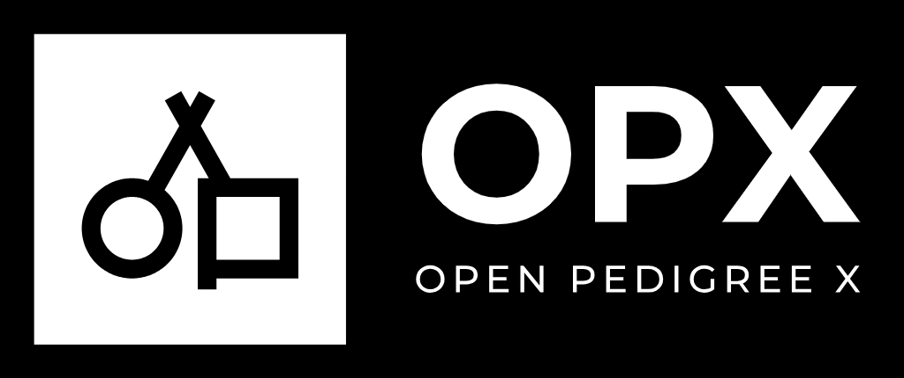

# Open Pedigree X

<p align="center">
  
</p>

<p align="center">
  <a href="https://fabianoposwar.com/pedigree/" target="_blank" rel="noopener noreferrer">
    
  </a>
  <a href="https://opensource.org/licenses/LGPL-2.1" target="_blank" rel="noopener noreferrer">
    
  </a>
</p>

Open Pedigree X is an enhanced fork of [PhenoTips/open-pedigree](https://phenotips.com) built on [Prototype](https://prototypejs.org) and [Raphaël](https://dmitrybaranovskiy.github.io/raphael/). It optimizes genomic pedigree drawing for modern clinical workflows with mobile/touch support, advanced genetic modeling, cloud storage, and bi-directional Invitae/Progeny XML compatibility.


---

## Key Features & Enhancements

### 🧬 Clinical Modeling & Genetics
- **Structured Genetic Tests (`G`)**: Per-person records with HGNC lookup (MyGene.info), HGVS variants (`c.`/`p.`), zygosity, ACMG tier, and pedigree-level line labels (e.g., `BRCA1 c.68_69del P`). Positive results color nodes and integrate into cascade analysis.
- **Detailed Diagnosis & Oncology**: Annotate basis, age of onset, and diagnosis age (`dx 51y`). Includes tailored cancer fields (laterality, ER/PR/HER2, grade, stage).
- **Cascade Testing**: Bayesian risk modeling for blood relatives up to the 3rd degree. Accounts for inheritance patterns (AD, AR, X-linked Haldane equilibrium, mitochondrial), age-dependent penetrance, existing test results, and consanguinity. Exportable to CSV.
- **High-Resolution PNG & Copy as Image**: Export the pedigree as PNG at 150/300/600 DPI (DPI written in the file, so it prints at the right size), with optional legend, black-and-white patterns and transparent background; *Tools → Copy as image* puts a 300 DPI PNG with legend on the clipboard, ready to paste into a report or e-mail.
- **Mode of Inheritance Fit**: The cascade dialog ranks AD, AR, XLR, XLD, mitochondrial and Y-linked by how well each explains the recorded affected/unaffected relatives, the index's sex and phenotype, and test results (likelihood under each mode's penetrance, de novo and onset settings, compared with equal prior weight), and suggests switching when another mode fits clearly better.
- **Wright's Inbreeding Coefficient (F)**: For consanguineous couples whose common ancestors are drawn, F of their children is shown above the couple's line (e.g., `F = 1/16` for first cousins) and in the couple's menu with the coefficient of relationship; the index person's F appears in cascade testing (and its CSV) and in the family history summary. Computed recursively, so inbred common ancestors are accounted for.
- **Family History Summary (`Y`)**: Writes the family history for the medical record in English or Portuguese, one line per relative in clinical order (parents and ancestry, father, mother, siblings with their children, the proband's children, maternal and paternal grandparents and uncles/aunts), with ages or ages at death, conditions with age at diagnosis, test results and comments; relatives with nothing recorded are grouped (e.g., *"- 3 tios e 1 tia (lado paterno), sem condições registradas."*).
- **CanRisk / BOADICEA v4 Export**: Generates compliant CanRisk files mapped with breast pathology, multi-gene panels, Ashkenazi ancestry flags, and generation IDs (`I-1`, `II-1`).
- **Ancestry Tracking**: Multi-ancestry tracking (gnomAD groups + founder populations) with per-node chart display.

### 🎨 Charting, Navigation & Usability
- **Search & Filters (`/` or `Ctrl+F`)**: Filter people by diagnosis, gene results, age, ancestry, or degree of relationship with real-time visual canvas rings.
- **Robust Graph Layout**: Full rendering support for complex family setups (consanguinity, childless couples, parentless siblings/individuals) and fixed single-parent alignment bugs. Reassignable probands.
- **Fast Keyboard Editing**: Single-key additions (`P` parents, `S` sibling, `C` child, `R` partner, `M`/`F`/`U` sex, `D` deceased, `N` notes).
- **Mobile & Touch**: Smooth pinch-to-zoom, pan, responsive header menus, and touch-calibrated hoverboxes.
- **Session Safety & History**: In-browser draft autosave prevents tab-close losses. View session undo/redo timelines in plain language via *Edit → History*.

### 💾 Interoperability & Cloud
- **Invitae / Progeny XML**: Full round-trip fidelity preserving `<condition_tests>`, `<surgical_removals>`, `<gail_properties>`, and pedigree notes.
- **Standard Imports/Exports**: Import from PED, LINKAGE, GEDCOM, BOADICEA, and GA4GH Pedigree (FHIR). Export vector PDFs with embedded round-trip XML or copy directly to clipboard.
- **Google Workspace Ready**: Native integration with Google Apps Script and Google Drive for cloud-based file management, auto-saving, and sidebar embedding.

---

## Getting Started

### Local Development

```bash
git clone https://github.com/faliwar/open-pedigree-xml.git
cd open-pedigree-xml
npm install
npm start
```
Open [http://localhost:9000/](http://localhost:9000/) in your browser.

### Google Apps Script Deployment

1. Run `npm install && npm run build` to compile `pedigree.min.js`.
2. In your Apps Script editor, configure `index.html`:

```html
<!DOCTYPE html>
<html>
  <head>
    <meta charset="UTF-8">
    <base target="_top">
    <title>Open Pedigree X</title>
    <script src="https://cdnjs.cloudflare.com/ajax/libs/prototype/1.7.3/prototype.js"></script>
    <script src="https://cdnjs.cloudflare.com/ajax/libs/scriptaculous/1.9.0/effects.js"></script>
    <script src="https://cdnjs.cloudflare.com/ajax/libs/scriptaculous/1.9.0/dragdrop.js"></script>
    <script src="https://cdnjs.cloudflare.com/ajax/libs/scriptaculous/1.9.0/slider.js"></script>
    <script src="https://cdnjs.cloudflare.com/ajax/libs/Blob.js/1.1.464287437/Blob.min.js"></script>
    <script src="https://cdnjs.cloudflare.com/ajax/libs/FileSaver.js/2.0.5/FileSaver.min.js"></script>
    <?!= include('xwiki-js'); ?>
    <?!= include('widgets-js'); ?>
    <?!= include('datetime-js'); ?>
    <?!= include('pedigree-js'); ?>
  </head>
  <body id='body'></body>
</html>
```

3. Wrap each dependency in `<script>` tags inside separate HTML files:
   - `xwiki-js.html` &larr; `public/vendor/xwiki/xwiki-min.js`
   - `widgets-js.html` &larr; `public/vendor/phenotips/Widgets.js`
   - `datetime-js.html` &larr; `public/vendor/phenotips/DateTimePicker.js`
   - `pedigree-js.html` &larr; `pedigree.min.js`

4. Add `Code.gs`:

```javascript
const FOLDER_ID = 'YOUR_FOLDER_ID_HERE';

function doGet() {
  return HtmlService.createTemplateFromFile('index')
      .evaluate()
      .setTitle('Open Pedigree X')
      .setXFrameOptionsMode(HtmlService.XFrameOptionsMode.ALLOWALL);
}

function include(filename) {
  return HtmlService.createHtmlOutputFromFile(filename).getContent();
}

function listXmlFiles() {
  var files = DriveApp.getFolderById(FOLDER_ID).getFiles();
  var result = [];
  while (files.hasNext()) {
    var f = files.next();
    if (f.getName().toLowerCase().endsWith('.xml')) {
      result.push({ id: f.getId(), name: f.getName(), lastUpdated: f.getLastUpdated().toISOString() });
    }
  }
  return result.sort((a, b) => new Date(b.lastUpdated) - new Date(a.lastUpdated));
}

function loadXmlFile(id) { return DriveApp.getFileById(id).getBlob().getDataAsString(); }
function saveXmlFile(id, content) { DriveApp.getFileById(id).setContent(content); }
function createXmlFile(name, content) {
  var file = DriveApp.getFolderById(FOLDER_ID).createFile(name, content, 'application/xml');
  return { id: file.getId(), name: file.getName() };
}
```

5. Deploy as a Web App.

---

## Contributing & Support

Contributions are welcome! Fork the repository and open a pull request (first-time contributors will be asked to sign a CLA).

For bug reports or feature suggestions, open an issue on GitHub. For commercial and enterprise editions, contact [PhenoTips](https://phenotips.com/).

## License

- Copyright (c) 2019-2022 Gene42 Inc. o/a PhenoTips
- Copyright (c) 2026 Fabiano Poswar

Licensed under the [LGPL-2.1](https://opensource.org/licenses/LGPL-2.1).
