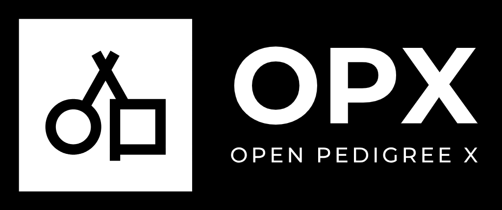
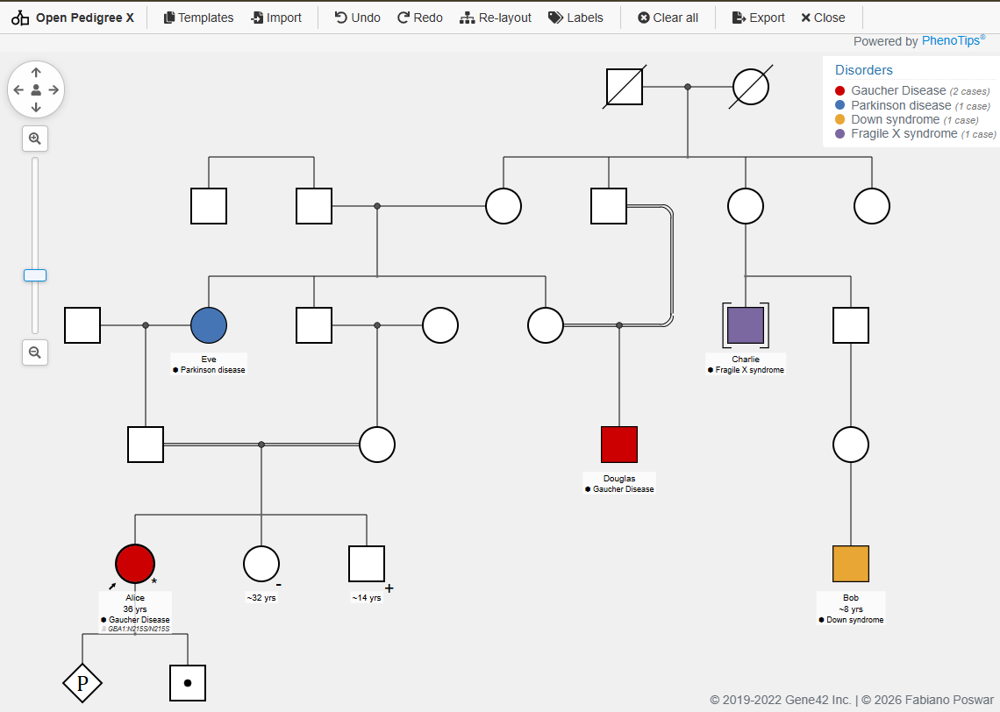

# Open Pedigree X

<p align="center">
  
</p>

<p align="center">
  <a href="https://fabianoposwar.com/pedigree/" target="_blank" rel="noopener noreferrer">
    
  </a>
  <a href="https://opensource.org/licenses/LGPL-2.1" target="_blank" rel="noopener noreferrer">
    
  </a>
</p>

## A free and open-source pedigree tool powered by PhenoTips®

Open Pedigree X is a robust browser-based genomic pedigree drawing solution using [Prototype](https://prototypejs.org), [Raphaël](https://dmitrybaranovskiy.github.io/raphael/), and [PhenoTips](https://phenotips.com).



This repository forks phenotips/open-pedigree and adapts it for compatibility with Invitae/Progeny XML formats. It is configured for deployment to Google Apps Script and uses Google Drive for storage.

## Features

✔ Robust support for complex families, intergenerational linkages, and consanguinity

✔ Shade nodes with disorders and/or candidate genes

✔ Quickly start with family templates

✔ Automatic consanguinity detection

✔ Import from PED, LINKAGE, GEDCOM (Cyrillic), BOADICEA, or GA4GH Pedigree (FHIR)

## Changes in this Fork (Open Pedigree X)

This repository (`open-pedigree-xml`) is an enhanced fork of the original Open Pedigree project, rebranded as **Open Pedigree X**. It introduces comprehensive optimizations for modern clinical and research workflows, complete mobile/touch support, enhanced demographic modeling, and native cloud integration:

### 📱 Responsive Mobile & Touch Support
* **Mobile-Optimized Interface**: Fully reworked header bar, responsive action menus, sliding drawers, backdrop overlays, and mobile-friendly dialogs.
* **Touch Zoom & Pan**: Pinch-to-zoom and pan gestures calibrated specifically for touch screens with bug fixes for zoom boundaries and hoverbox interactions.
* **Dynamic Hoverboxes**: Adapted node hover actions and editing menus for touch and pointer events without displacement glitches.

### 🧬 Family Modeling & Graph Enhancements
* **Complex Family Support**: Full support for parentless persons, parentless siblings, and childless couples without layout breakdown.
* **Proband Flexibility**: Ability to seamlessly change or reassign the proband across the pedigree.
* **Single-Parent Layout Fixes**: Resolved staircase displacement effects and node shifts in single-parent offspring lineages.
* **Displacement Bug Fixes**: Corrected automatic node positioning, intergenerational alignments, and consanguinity connection rendering.

### 📋 Clinical Demographics & Phenotype Annotations
* **Direct Age Input & Calculation**: Enter age directly with automated calculation, robust handling of approximate date of birth (DOB), and death age tracking.
* **Unified Name Fields**: Streamlined single-field full name input for faster data entry.
* **Optimized Disease & Phenotype Search**: Integrated lookup and autocomplete optimizations (including Ontology Lookup Service suggestions).
* **Carrier & Genetic Marker Support**: Added support for `+` and `-` allele and marker notation.
* **Configurable Node Labels**: Custom display options to toggle and reorder visible node metadata (names, DOB, age, phenotypes, genotypes).

### 💾 Import, Export & File Formats
* **Invitae/Progeny XML**: Comprehensive import and export compatibility for clinical XML pedigree files, including miscarriage and abortion modeling.
* **Drag-and-Drop Import**: Drag XML or supported pedigree files directly into the workspace canvas.
* **Round-Trip PDF Embeds**: Export high-resolution pedigree PDFs with embedded XML metadata, allowing exported PDFs to be reopened and updated later.
* **Export to Clipboard**: Quick-copy pedigree image data directly to the system clipboard for immediate pasting into clinical notes, slides, or EHRs.
* **Corrected GA4GH Pedigree (FHIR)**: Fixed export compatibility with the GA4GH Pedigree FHIR profile.

### ☁️ Google Workspace & Cloud Integration
* **Google Apps Script & Drive Deployment**: Native integration to run as an Apps Script web app or container-bound sidebar.
* **Drive File Management**: Browse, load, autosave, and rename pedigree XML files directly to Google Drive (with URL/file ID deep linking).
* **Environment-Aware Toolbars**: Automatically reveals Drive features when hosted inside Google Apps Script, cleanly falling back to local file modes in standalone browsers.

### 🎨 Visual & Styling Modernization
* **Clean White Background**: Crisp, publication-ready white canvas background for high-contrast exports and presentations.
* **Updated Branding & Assets**: High-resolution icons and transparent UI marks for desktop and mobile viewports.

## Getting started

### Command line

Quickly get started with Open Pedigree X on your computer:
```
git clone https://github.com/faliwar/open-pedigree-xml.git
cd open-pedigree-xml
npm install
npm start
```
Open a browser to http://localhost:9000/

### Google Apps Script

This version of Open Pedigree X is optimized to run as a web app or sidebar within Google Apps Script and can save/load XML files directly from a designated Google Drive folder.

The best way to deploy it is by separating the HTML and JS files in your Apps Script project.

1. Build the optimized bundle locally by running `npm install` and `npm run build`.
   The build also updates `version.json` from the generated bundle hash. For the regular static app, deploy `index.html`, `pedigree.min.js`, and `version.json` together; no manual version bump or `index.html` edit is needed. For Apps Script, paste the newly built bundle into `pedigree-js.html` after each build.
2. In your Google Apps Script editor, create an `index.html` file using the `include` pattern:
```html
<!DOCTYPE html>
<html>
  <head>
    <meta charset="UTF-8">
    <base target="_top">
    <title>Open Pedigree X</title>

    <script src="https://cdnjs.cloudflare.com/ajax/libs/prototype/1.7.3/prototype.js"></script>
    <script src="https://cdnjs.cloudflare.com/ajax/libs/scriptaculous/1.9.0/effects.js"></script>
    <script src="https://cdnjs.cloudflare.com/ajax/libs/scriptaculous/1.9.0/dragdrop.js"></script>
    <script src="https://cdnjs.cloudflare.com/ajax/libs/scriptaculous/1.9.0/slider.js"></script>
    <script src="https://cdnjs.cloudflare.com/ajax/libs/Blob.js/1.1.464287437/Blob.min.js"></script>
    <script src="https://cdnjs.cloudflare.com/ajax/libs/FileSaver.js/2.0.5/FileSaver.min.js"></script>

    <?!= include('xwiki-js'); ?>
    <?!= include('widgets-js'); ?>
    <?!= include('datetime-js'); ?>
    <?!= include('pedigree-js'); ?>
  </head>
  <body id='body'>
  </body>
</html>
```

3. Create the corresponding HTML files in your Apps Script project to hold the scripts:
   - Create `xwiki-js.html` and paste the contents of `public/vendor/xwiki/xwiki-min.js` wrapped in `<script>` tags.
   - Create `widgets-js.html` and paste the contents of `public/vendor/phenotips/Widgets.js` wrapped in `<script>` tags.
   - Create `datetime-js.html` and paste the contents of `public/vendor/phenotips/DateTimePicker.js` wrapped in `<script>` tags.
   - Create `pedigree-js.html` and paste the entire contents of your newly built `pedigree.min.js` wrapped in `<script>` tags.
   
   *Example structure for these files:*
```html
<script>
  // Paste file contents here
</script>
```

4. Create your `Code.gs` file with the following server-side logic:
```javascript
// Replace with the Google Drive folder ID where you want to save XMLs
const FOLDER_ID = 'YOUR_FOLDER_ID_HERE';

function doGet() {
  return HtmlService.createTemplateFromFile('index')
      .evaluate()
      .setTitle('Open Pedigree X')
      .setXFrameOptionsMode(HtmlService.XFrameOptionsMode.ALLOWALL);
}

// Utility for injecting HTML files into the index
function include(filename) {
  return HtmlService.createHtmlOutputFromFile(filename).getContent();
}

// --- DriveBackend.js Server-Side Requirements ---
function listXmlFiles() {
  var folder = DriveApp.getFolderById(FOLDER_ID);
  var files = folder.getFiles();
  var result = [];

  while (files.hasNext()) {
    var f = files.next();
    var name = f.getName();

    if (name.toLowerCase().endsWith('.xml')) {
      result.push({
        id: f.getId(),
        name: name,
        lastUpdated: f.getLastUpdated().toISOString()
      });
    }
  }

  result.sort(function(a, b) {
    return new Date(b.lastUpdated) - new Date(a.lastUpdated);
  });

  return result;
}

function loadXmlFile(fileId) {
  return DriveApp.getFileById(fileId).getBlob().getDataAsString();
}

function saveXmlFile(fileId, content) {
  DriveApp.getFileById(fileId).setContent(content);
}

function createXmlFile(fileName, content) {
  var folder = DriveApp.getFolderById(FOLDER_ID);
  var file = folder.createFile(fileName, content, 'application/xml');
  return { id: file.getId(), name: file.getName() };
}
```
5. Deploy your script as a Web App to test the application!

## Contributing

Contributions welcome! Fork the repository and create a pull request to share your improvements with the community.

In order to ensure that the licensing is clear and stays open, you'll be asked to sign a CLA with your first pull request.


## Support

This is free software! Create an issue in GitHub to ask others for help, or try fixing the issue yourself and then make a pull request to contribute it back to the core.

If you are interested in the Enterprise/commercial version, please contact [PhenoTips](https://phenotips.com/).


## License

Copyright (c) 2019-2022 Gene42 Inc. o/a PhenoTips

Copyright (c) 2026 Fabiano Poswar

Open Pedigree is distributed under the [LGPL-2.1](https://opensource.org/licenses/LGPL-2.1) (GNU Lesser General Public License).

You can easily comply with this license by:
* including prominent notice of the use of Open Pedigree in your software
* retaining all copyright notices in the software
* ensuring that any and all changes you make to the software are published and open-sourced under the LGPL
